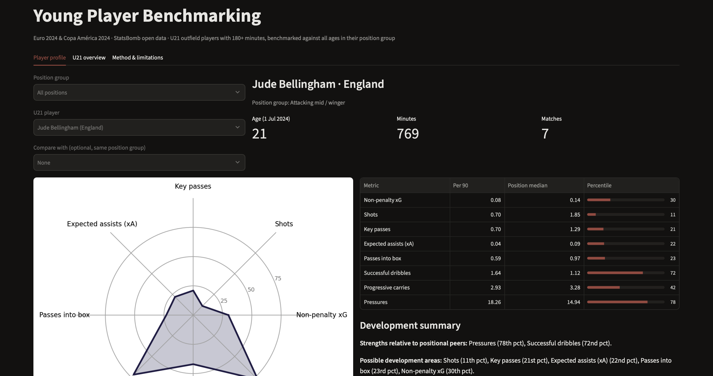

# Young Player Benchmarking — Euro 2024 & Copa América 2024

An interactive app that benchmarks **under-21 players** against everyone in their position group at Euro 2024 and Copa América 2024, using **StatsBomb open event data**. It is designed the way an academy analyst might present data to coaches: one player at a time, with clear percentiles, a written development summary and honest caveats about sample size.

**Live app:** _add your Streamlit link here_



## What it does

- **Player profile:** pick a U21 player to see a percentile radar, per-90 numbers against the position median, and a plain-language summary of strengths and possible development areas. You can overlay any other player in the same position group for comparison.
- **U21 overview:** all 27 qualifying U21 outfield players in one sortable table.
- **Method & limitations:** definitions and caveats, shown inside the app.

## Data and method

| | |
|---|---|
| **Matches** | 83 (Euro 2024: 51, Copa América 2024: 32), about 288,000 events |
| **Players** | 395 outfield players with 180+ minutes; 27 aged U21 (21 or under on 1 July 2024) |
| **Ages** | Birth dates from the tournaments' published squad lists, linked to StatsBomb player IDs |
| **Minutes** | Calculated from lineup position spells; penalty shoot-outs excluded |
| **Position groups** | StatsBomb's 23 positions mapped to 6 groups; each player is assigned the group where they played most minutes |
| **Benchmark** | Percentiles within position group, against **all ages** |

**Metric templates** (8 per role) cover progression (progressive passes and carries, passes into the final third and the box), chance creation (key passes, xA), shooting (non-penalty xG, shots), ball-carrying (successful dribbles, ball losses) and defending (tackles + interceptions, recoveries, clearances, pressures).

*Progressive* passes and carries move the ball at least 30 units closer to goal within a team's own half, 15 when crossing halfway and 10 in the opposition half. Set pieces are excluded.

## Example findings

- **Lamine Yamal (16)** ranked in the 94th–98th percentile of attacking midfielders/wingers for progressive carries, key passes and xA, which is elite output at any age.
- **Arda Güler (19)** ranked in the 95th–98th percentile among strikers for key passes and xA, which reflects a creative player tagged as a striker by formation (see Limitations).
- U21 players were concentrated in attacking roles (15 of 27). Only 2 centre-backs and 3 central midfielders reached 180 minutes, which suggests coaches trust young attackers before young defenders at senior tournaments.

## Data-quality checks

- **Missing teams:** an early version silently dropped most of Germany and England. Players with no nickname had a blank name, and pandas drops blank keys when grouping. It was caught by checking team counts against known squads, and fixed with an explicit missing-value check.
- **Name matching:** joining birth dates by name failed twice ("Kenan Yıldız" vs "Kenan Yildiz", and "Conceição" also matching Rafael Leão's full name). Joins now use StatsBomb player IDs.
- **Sample size:** a 180-minute minimum, and a warning in the app for players under 360 minutes.

## Limitations

- Tournament samples are small (3–7 matches), so one game can move a player's numbers a lot.
- Output reflects team style and role as well as individual ability.
- Position groups follow StatsBomb's formation tags and may differ from a coach's view.
- Event data does not capture off-ball movement or physical output; tracking and GPS data would.
- The development summary is a prompt for video review and coach discussion, not a verdict.

## Run it yourself

```bash
pip install -r requirements.txt
python step1_build_minutes.py   # downloads StatsBomb open data (~2 min), builds minutes
python step2_metrics.py         # per-90 metrics and percentiles
streamlit run app.py
```

`data/events.pkl` (about 340 MB) is not stored in the repo; step 1 recreates it. The app only needs `data/player_metrics.csv`.

## Credits

Event data: [StatsBomb Open Data](https://github.com/statsbomb/open-data). Built by Angelo Sajan Kalathil with Python, pandas, matplotlib and Streamlit.
